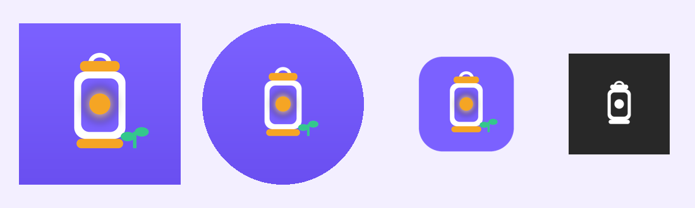
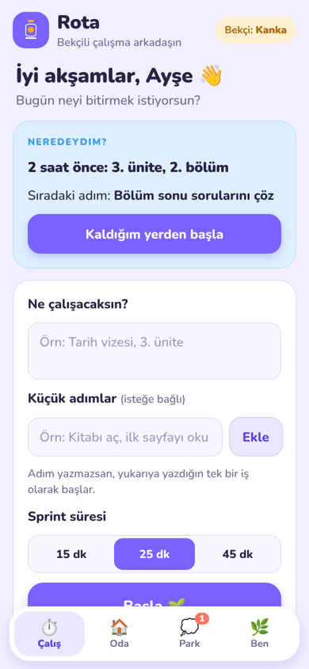
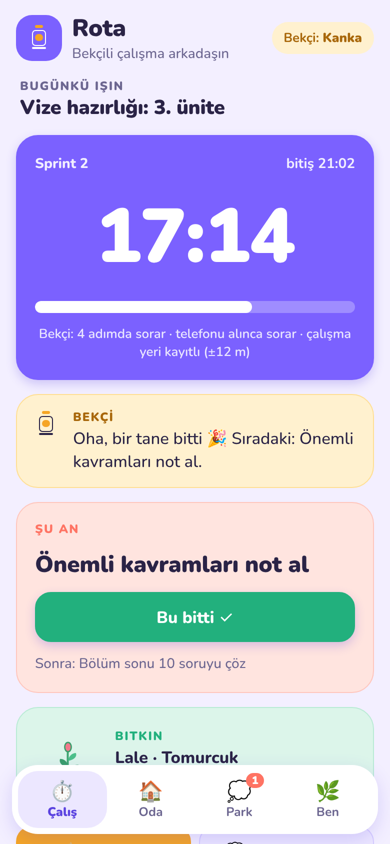
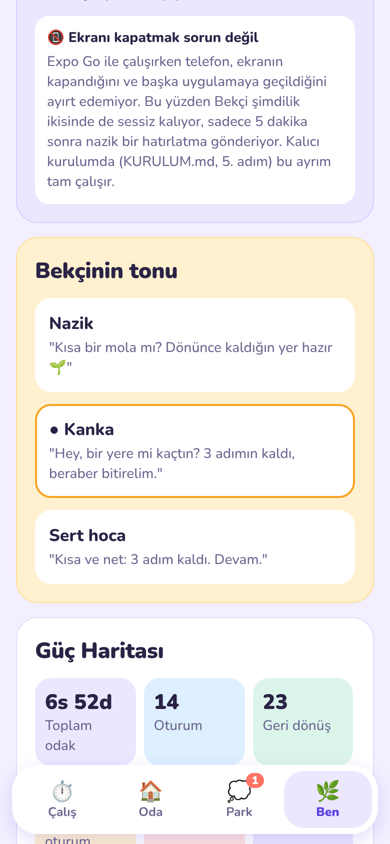
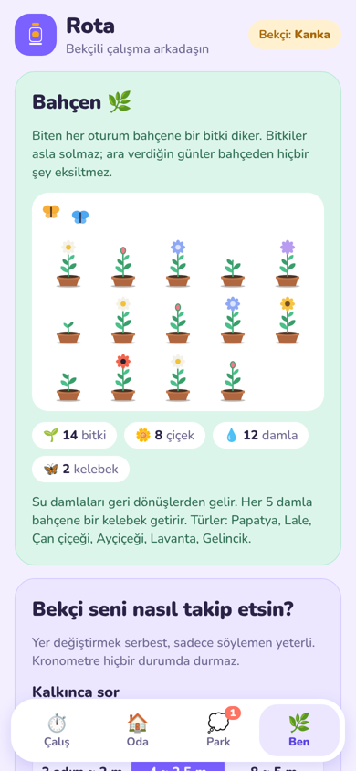
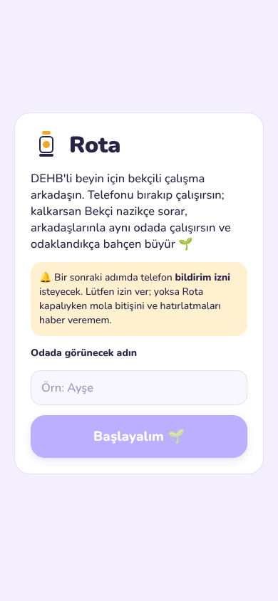
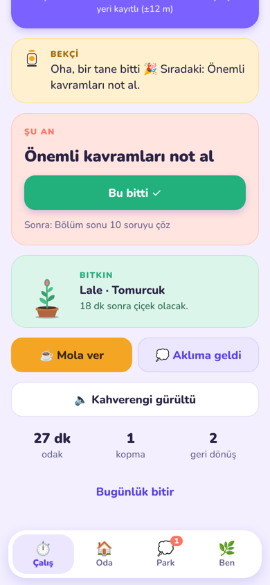
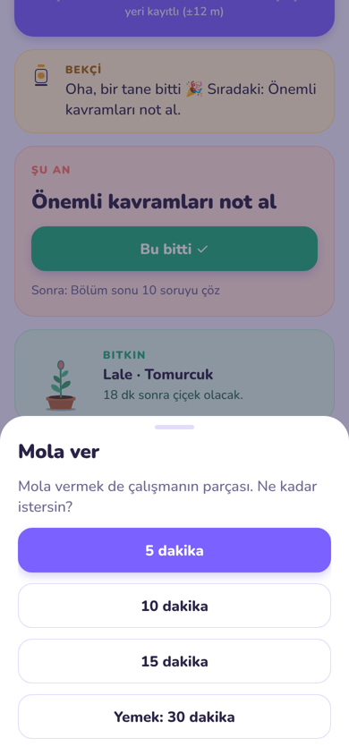
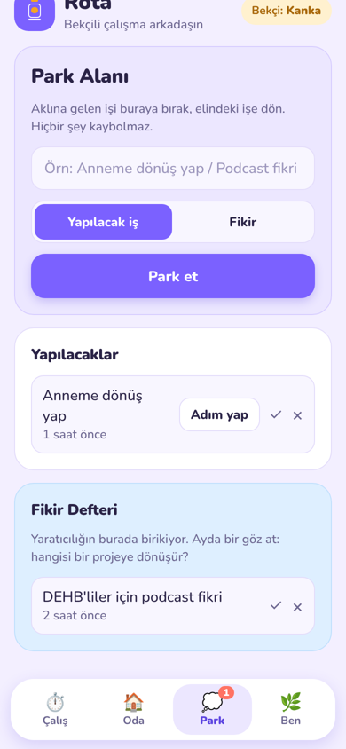
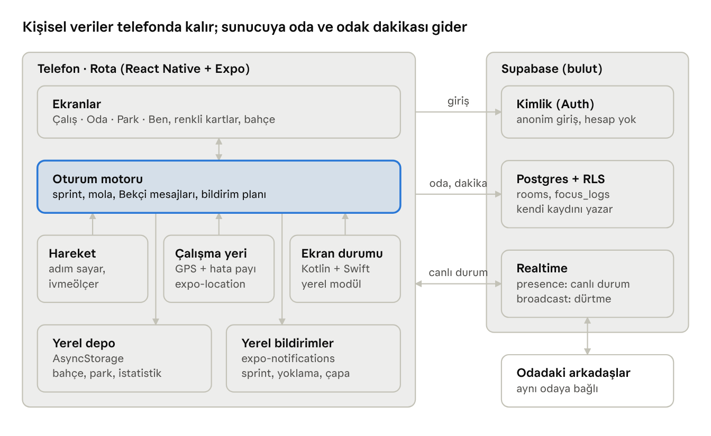

<p align="center">
  
</p>

<h1 align="center">Rota</h1>
<p align="center"><b>DEHB'li beyin için bekçili çalışma arkadaşı</b><br/>
<i>A gentle, sensor-aware focus app for people with ADHD</i></p>

<p align="center">
  React Native · Expo SDK 58 · TypeScript · Supabase · Kotlin · Swift
</p>

---

Rota, DEHB'li öğrencilerin çalışmaya başlamasını, odakta kalmasını ve koptuğunda geri dönmesini sağlayan bir mobil uygulama. DEHB'de farklı çalışan "iç yönetici" işini dışarıdan üstleniyor: İşi küçük adımlara bölüyor, zamanı görünür kılıyor, telefonla kalkınca ya da başka bir uygulamaya geçince **suçlamadan, nazikçe** soruyor. Arkadaşlarla canlı ortak çalışma odaları ve asla solmayan bir bahçe de içinde.

> **EN:** Rota helps people with ADHD start, stay focused and come back after drifting. It uses the step counter, accelerometer and GPS to notice when you get up, a small native module to tell "screen off" from "switched to another app", live study rooms over Supabase Realtime, and a no-streak, never-wilting garden for gentle motivation.

## Ekranlar

| Yeni oturum | Çalışırken | Bekçi ayarları | Bahçe |
|---|---|---|---|
|  |  |  |  |

| Açılış | Oturumun altı | Mola | Park Alanı |
|---|---|---|---|
|  |  |  |  |

## Neden?

Proje, DEHB'li üniversite öğrencilerinin günlük hayatta yaşadığı somut sorunlardan yola çıktı:

| Sorun | Rota'daki karşılığı |
|---|---|
| 30 dakika çalışmak için 2 saat hazırlanmak | Tek tuşla başlangıç, küçük ilk adım, kahverengi gürültü |
| Bir işten diğerine atlayıp ne yaptığını unutmak | Park Alanı ve "Neredeydim?" kartı |
| Biri başında beklerken daha iyi çalışmak | Bekçi ve ortak çalışma odaları |
| Telefona kapılıp kopmak | Hareket, konum ve uygulama değiştirme algılama |
| Hiperodakta zamanı kaçırmak | Zaman Çapası: çıkış saati hesabı ve kademeli uyarı |
| "Seriyi bozdun" suçluluğu | Asla solmayan bahçe, seri yok |

## Özellikler

- **Çalışma oturumu:**
  - 15, 25 ya da 45 dakikalık sprintler. Kronometre arka planda da sürer.
  - Tek dokunuşla mola.
  - "Neredeydim?" kartı: Bırakırken kaldığın yeri kaydeder, döndüğünde ilk onu gösterir.
- **Bekçi:** Üç tonu var: Nazik, Kanka, Sert hoca. Mesajlar o anki adıma göre değişir. Hiçbir tonda suçlama yok.
- **Hareket bekçisi:** Telefonla yaklaşık 2 metre yürürsen adım sayarla "Nereye?" diye sorar. Telefonu eline aldığını ivmeölçerle algılar.
- **Çalışma yeri:** GPS'in kendi hata payını hesaba katarak kafeden ya da evden çıktığını fark eder.
- **Ekran ve uygulama ayrımı:** Ekranı kapatmak sorun sayılmaz. Başka bir uygulamaya geçince nazik bir hatırlatma gelir.
- **Ortak çalışma odaları:**
  - 6 haneli kodla katılım.
  - Herkesin durumu canlı görünür.
  - Dürtme ve alkış.
  - "Beraber sprint" ve günlük odak tablosu.
- **Bahçe:** Her oturumda bir bitki büyür. Bitkiler asla solmaz. Geri dönüşler su damlası ve kelebek kazandırır.
- **Park Alanı ve Fikir Defteri, Zaman Çapası, Güç Haritası**

## Mimari



| Katman | Teknoloji |
|---|---|
| Uygulama | React Native 0.88, Expo SDK 58, TypeScript |
| Sunucu | Supabase: PostgreSQL + satır düzeyinde güvenlik (RLS), anonim giriş, Realtime (presence + broadcast) |
| Sensörler | `expo-sensors` (adım sayar, ivmeölçer), `expo-location` |
| Yerel modül | Expo Modules API: Kotlin (Android `ACTION_SCREEN_OFF`) ve Swift (iOS kilit bildirimi) → [`modules/screen-state`](modules/screen-state) |
| Bildirim ve geri bildirim | `expo-notifications`, `expo-haptics`, `expo-audio`, `expo-keep-awake` |
| Derleme | EAS Build (Android .apk), web sürümü için `expo export` |

## Öne çıkan teknik kararlar

- **GPS 2 metreyi ölçemez.** Bu yüzden her mesafe kendine uygun sensöre verildi:
  - Ev içi hareket: adım sayar.
  - Telefonu eline alma: ivmeölçer.
  - Mekândan çıkış: GPS, hata payı eşiğiyle birlikte.
  - Telefon masada kalırsa: periyodik "Orada mısın?" yoklaması.
- **Ekran kapanması ile uygulama değiştirme ayrımı.** React Native'in `AppState` API'si iki durumda da sadece "background" diyor. Bunu ayırt etmek için küçük bir yerel modül yazıldı. Modül yoksa (Expo Go, web) uygulama çökmeden sessiz bir moda geçiyor.
- **Zaman damgası tabanlı oturum motoru.** Kronometre, uygulama arka plandayken de doğru çalışıyor. Sprint sonu ve yoklamalar ayrıca etiketli yerel bildirimler olarak planlanıyor.
- **Gizlilik.**
  - Konum, bahçe ve park listesi sadece telefonda kalır. Sunucuya yalnızca oda adı, görünen ad ve biten oturumun dakikası gider.
  - RLS kuralları sayesinde herkes sadece kendi adına kayıt yazabilir.

## Çalıştırma

```bash
npm install
npm run kontrol     # Supabase bağlantısını kontrol eder
npm run baslat      # geliştirme sunucusu
npm run apk         # Android .apk (EAS Build)
npm run web         # web sürümü → dist/
```

Supabase kurulumu ve adım adım rehber için: [KURULUM.md](KURULUM.md). Veritabanı şeması: [`supabase/schema.sql`](supabase/schema.sql).

> `src/config.ts` içindeki anahtar Supabase'in **publishable** anahtarıdır. Bu anahtar istemcide durmak için tasarlanmıştır, veritabanını RLS kuralları korur. Kendi projen için kendi Supabase bilgilerini yaz.

## Durum

Çalışan prototip: Android'de kurulu ve test ediliyor. iPhone için web sürümü kullanılıyor. Sıradaki adımlar:
- Uygulama kapalıyken dürtme bildirimleri (push)
- Ortak oda bahçesi
- Okuma asistanı (aktif hatırlama)
- TestFlight ile iOS sürümü

## Lisans

© 2026 AycaSudem. **Tüm hakları saklıdır.** Kod yalnızca inceleme ve portfolyo amacıyla paylaşılmıştır; izin almadan kopyalanamaz, kullanılamaz ya da dağıtılamaz. Ayrıntılar için [LICENSE](LICENSE).
